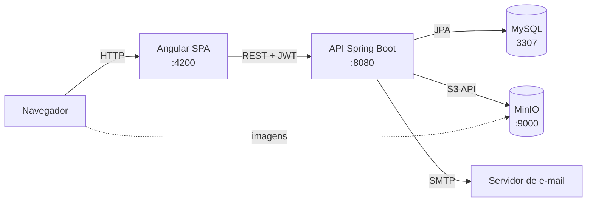
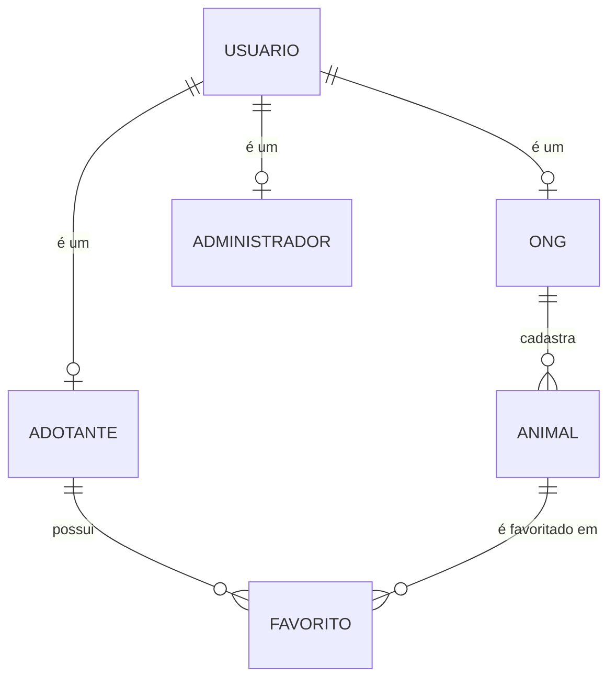

# L.A.R. — Lar, Adoção e Recomeço

Plataforma web que conecta **ONGs e protetores de animais** a **pessoas interessadas em adotar**, reunindo em um só lugar um catálogo filtrável de animais disponíveis, o perfil de cada instituição e as ferramentas de gestão para quem cadastra e para quem modera.

> Trabalho de Graduação do curso de **Análise e Desenvolvimento de Sistemas** da **Fatec Itu – Dom Amaury Castanho**.

---

## Sumário

- [Sobre o projeto](#sobre-o-projeto)
- [Por que o L.A.R. existe](#por-que-o-lar-existe)
- [Perfis de usuário e funcionalidades](#perfis-de-usuário-e-funcionalidades)
- [Regras de negócio principais](#regras-de-negócio-principais)
- [Tecnologias](#tecnologias)
- [Arquitetura](#arquitetura)
- [Estrutura do repositório](#estrutura-do-repositório)
- [Como rodar localmente](#como-rodar-localmente)
- [Variáveis de ambiente](#variáveis-de-ambiente)
- [Documentação da API](#documentação-da-api)
- [Modelo de dados](#modelo-de-dados)
- [Segurança](#segurança)
- [Equipe e contexto acadêmico](#equipe-e-contexto-acadêmico)

---

## Sobre o projeto

O L.A.R. é uma aplicação **SPA (Single Page Application)** em Angular que consome uma **API REST** em Java/Spring Boot. O objetivo é tornar a adoção de animais mais acessível, segura e transparente:

- **adotantes** navegam por um catálogo único, filtram por características e salvam favoritos;
- **ONGs e protetores independentes** cadastram e gerenciam seus animais, depois de aprovados por um administrador;
- **administradores** analisam cadastros de ONGs, gerenciam usuários e têm todas as suas ações registradas em auditoria.

## Por que o L.A.R. existe

O abandono de animais é um problema social grave no Brasil, e os abrigos e ONGs dividem o mesmo gargalo: **divulgar os animais e alcançar adotantes preparados**. Do outro lado, quem quer adotar um animal com características específicas (espécie, raça, porte, idade) precisa procurar em vários lugares, sem uma fonte unificada de informação.

A pergunta que norteia o trabalho é:

> *Como uma plataforma digital integrada pode facilitar a adoção responsável e melhorar a interação entre ONGs e adotantes?*

**Objetivos específicos**

- Oferecer uma plataforma digital para cadastro e gerenciamento de animais disponíveis para adoção.
- Permitir que ONGs registrem e atualizem as informações dos animais de forma organizada.
- Disponibilizar busca e filtragem por espécie, raça, porte, idade e cor.
- Facilitar o acesso às informações das instituições responsáveis pelos animais.
- Ampliar a visibilidade dos animais resgatados e apoiar a adoção responsável.

---

## Perfis de usuário e funcionalidades

| Perfil | O que pode fazer |
| --- | --- |
| **Visitante** | Consultar o catálogo público de animais (com filtros e paginação), ver detalhes de animais e ONGs, cadastrar-se como adotante ou ONG, recuperar senha. |
| **Adotante** | Tudo do visitante, mais: favoritar e desfavoritar animais, listar seus favoritos, gerenciar o próprio perfil. |
| **ONG / protetor** | Cadastrar, editar, alterar o status e excluir seus animais (com foto), gerenciar o perfil institucional, incluindo a foto da ONG. Só opera após aprovação de um administrador. |
| **Administrador** | Aprovar ou recusar cadastros de ONGs (com motivo), listar ONGs por status, gerenciar usuários (buscar, bloquear/desbloquear, corrigir CPF/CNPJ), consultar o registro de auditoria. |
| **Superadministrador** | Tudo do administrador, mais: convidar novos administradores e bloquear outros administradores. |

**Funcionalidades transversais (todos os usuários autenticados)**

- Autenticação com login/logout e recuperação de senha por e-mail.
- Alteração de senha, alteração de e-mail (com confirmação por link) e exclusão de conta.
- Notificações por e-mail nos eventos relevantes (aprovação/recusa de ONG, bloqueio/desbloqueio, alteração de documento, convites, confirmações).

**Catálogo de animais** — filtros disponíveis: espécie, porte, sexo, raça, cor, faixa de idade, status e ONG responsável, com paginação e ordenação.

---

## Regras de negócio principais

**Cadastro e aprovação de ONGs**
- Todo cadastro de ONG nasce com status `PENDENTE` e passa pela análise de um administrador, que pode **aprovar** ou **recusar** (informando o motivo). A decisão pode ser **reanalisada a qualquer momento**, e a ONG é avisada por e-mail.
- O CNPJ é **opcional**, para acolher **protetores independentes**; o mesmo fluxo de aprovação se aplica a eles.
- CPF e CNPJ são validados pelos **dígitos verificadores**, não apenas pelo formato, e não podem se repetir no sistema.

**Visibilidade no catálogo público**
- O catálogo mostra, por padrão, apenas animais `DISPONIVEL`.
- Animais de ONGs **bloqueadas** ou **não aprovadas** (pendentes ou recusadas) **não aparecem** no catálogo público.

**Moderação e administração**
- O administrador **suspende** contas (bloqueio), em vez de excluí-las, e pode enviar uma mensagem opcional que segue por e-mail ao usuário. Um administrador não pode bloquear a si mesmo, e nunca é possível bloquear o único administrador ativo.
- Apenas o **superadministrador** pode bloquear outros administradores ou convidar novos. O superadministrador inicial é criado automaticamente na primeira execução (ver [Como rodar localmente](#como-rodar-localmente)).
- Novos administradores são cadastrados por **convite**: o superadministrador informa os dados, e o convidado recebe um link por e-mail (válido por 15 minutos) para **definir a própria senha**. Novos administradores nunca nascem com privilégio de superadministrador.
- O administrador só pode editar **CPF** e **CNPJ** de terceiros (casos excepcionais). Nome, e-mail, telefone e endereço pertencem ao próprio usuário. Cada correção é auditada e notificada por e-mail ao dono da conta, com justificativa opcional.
- **Todas as ações administrativas** geram um registro de auditoria imutável (quem, o quê, quando e qual registro foi afetado), consultável por responsável e por data.

**Contas**
- Fluxos sensíveis (recuperação de senha, troca de e-mail, exclusão de ONG, ativação de administrador) usam **tokens com expiração** enviados por e-mail.
- A exclusão de conta de ONG exige confirmação por e-mail, pois remove também os animais cadastrados por ela. O superadministrador não pode excluir a própria conta.

---

## Tecnologias

| Camada | Tecnologia |
| --- | --- |
| **Frontend** | Angular 17 (componentes standalone), TypeScript 5.4, Bootstrap 5.3, RxJS |
| **Backend** | Java 21, Spring Boot 4.1, Spring Web MVC, Spring Data JPA (Hibernate), Spring Validation, Spring Mail |
| **Segurança** | Spring Security, JWT stateless (jjwt 0.12), senhas com BCrypt |
| **Banco de dados** | MySQL 8.4 |
| **Armazenamento de imagens** | MinIO (compatível com S3) |
| **Documentação da API** | springdoc-openapi (Swagger UI) |
| **Infraestrutura local** | Docker e Docker Compose (MySQL + MinIO) |
| **Build** | Maven Wrapper (backend) e Angular CLI/npm (frontend) |

**Metodologia e apoio ao projeto:** Kanban (Trello), prototipação de interface no Figma e versionamento com Git/GitHub.

---

## Arquitetura

O frontend é uma SPA que conversa com uma API REST **stateless**: cada requisição autenticada carrega um token JWT no cabeçalho `Authorization`. As fotos dos animais e das ONGs ficam no MinIO, fora do banco relacional; o banco guarda apenas a URL.



**Organização do backend** — camadas bem separadas, com DTOs entre a API e as entidades (nenhuma entidade JPA é exposta diretamente nas respostas):

```
controllers  →  services  →  repositories  →  entities
     ↑              ↑
   dtos       specifications (filtros dinâmicos)
```

Erros seguem um formato padronizado (`timestamp`, `status`, `erro`, `mensagem`, `path`), e erros de validação trazem o mapa `campos` com a mensagem de cada campo inválido.

---

## Estrutura do repositório

```
L.A.R_Repository/
├── docker-compose.yml        # MySQL + MinIO (e criação do bucket de imagens)
├── .env                      # variáveis lidas pelo docker-compose
├── LAR_Backend/              # API REST (Spring Boot)
│   ├── pom.xml
│   ├── mvnw / mvnw.cmd       # Maven Wrapper
│   └── src/main/
│       ├── java/com/lar/
│       │   ├── config/         # configurações (segurança, CORS, seed do superadmin)
│       │   ├── controllers/    # endpoints REST
│       │   ├── dtos/           # objetos de entrada e saída da API
│       │   ├── entities/       # entidades JPA
│       │   ├── enums/          # StatusAnimal, StatusOng
│       │   ├── exceptions/     # exceções de negócio + tratamento global
│       │   ├── repositories/   # acesso a dados (Spring Data)
│       │   ├── security/       # filtro JWT e utilitários de autenticação
│       │   ├── services/       # regras de negócio
│       │   ├── specifications/ # filtros dinâmicos (animais, ONGs, auditoria)
│       │   ├── storage/        # integração com o MinIO
│       │   └── validators/     # validação de CPF/CNPJ
│       └── resources/
│           └── application.properties
└── LAR_Frontend/             # SPA (Angular)
    ├── angular.json
    ├── package.json
    └── src/app/
        ├── components/       # componentes reutilizáveis (navbar, animal-card, ...)
        ├── pages/            # telas, uma pasta por rota
        └── services/         # chamadas à API, guards e interceptor de autenticação
```

---

## Como rodar localmente

### Pré-requisitos

- **JDK 21**
- **Node.js** 18.19+ ou 20+ (com npm)
- **Docker** e **Docker Compose** (Docker Desktop no Windows/macOS)
- Git

> Não é preciso instalar o Maven: o repositório inclui o Maven Wrapper.

### 1. Clonar o repositório

```bash
git clone https://github.com/Leonardo-do-Playstation/L.A.R_Repository.git
cd L.A.R_Repository
```

### 2. Configurar o `.env`

Na raiz do projeto, o `.env` alimenta o `docker-compose.yml`. Use os valores que preferir (os de exemplo abaixo funcionam em desenvolvimento):

```env
MYSQL_DATABASE=lar_db
MYSQL_USER=lar_user
MYSQL_PASSWORD=troque-esta-senha
MYSQL_ROOT_PASSWORD=troque-esta-senha-root
MYSQL_PORT=3307
```

> Mantenha `MYSQL_PORT=3307`, a porta que o backend usa por padrão. Se o `.env` já existe no repositório, basta usá-lo como está.

### 3. Subir o banco e o armazenamento de imagens

```bash
docker compose up -d
```

Isso inicia o **MySQL** e o **MinIO** e cria automaticamente o bucket público de leitura `animais`. O console web do MinIO fica em `http://localhost:9001`.

### 4. Subir o backend

O backend lê a configuração de **variáveis de ambiente** (veja a [tabela abaixo](#variáveis-de-ambiente)); o arquivo `.env` **não** é lido pelo Spring. Cada variável tem um valor padrão de desenvolvimento em `application.properties`, então só é obrigatório definir `MYSQL_USER` e `MYSQL_PASSWORD` se você usou valores diferentes dos padrões (`admin` / `caramelo`) no `.env`, além das credenciais do superadministrador inicial. Depois execute:

**Windows (PowerShell)**

```powershell
cd LAR_Backend
$env:MYSQL_USER = "lar_user"
$env:MYSQL_PASSWORD = "troque-esta-senha"
$env:LAR_ADMIN_SEED_EMAIL = "admin@exemplo.com"
$env:LAR_ADMIN_SEED_PASSWORD = "uma-senha-forte"
.\mvnw.cmd spring-boot:run
```

**Linux / macOS**

```bash
cd LAR_Backend
export MYSQL_USER=lar_user
export MYSQL_PASSWORD=troque-esta-senha
export LAR_ADMIN_SEED_EMAIL=admin@exemplo.com
export LAR_ADMIN_SEED_PASSWORD=uma-senha-forte
./mvnw spring-boot:run
```

A API sobe em **`http://localhost:8080`**. As tabelas são criadas e atualizadas automaticamente pelo Hibernate na primeira execução.

**Superadministrador inicial.** Na primeira execução, se ainda não existir nenhum administrador e `LAR_ADMIN_SEED_EMAIL` / `LAR_ADMIN_SEED_PASSWORD` estiverem definidas (senha com ao menos 6 caracteres), o sistema cria o superadministrador (código `ADM-0001`). Use essas credenciais para o primeiro login.

### 5. Subir o frontend

```bash
cd LAR_Frontend
npm install
npm start
```

A aplicação abre em **`http://localhost:4200`**. O frontend espera a API em `http://localhost:8080`.

### Endereços úteis

| Serviço | URL |
| --- | --- |
| Aplicação (Angular) | http://localhost:4200 |
| API (Spring Boot) | http://localhost:8080 |
| Swagger UI | http://localhost:8080/swagger-ui.html |
| Console do MinIO | http://localhost:9001 |

### E-mails em desenvolvimento

O envio de e-mails (recuperação de senha, aprovação de ONG, convites, confirmações) usa SMTP configurado em `LAR_Backend/src/main/resources/application.properties`. Em desenvolvimento, o projeto aponta para uma caixa de testes **Mailtrap**, que captura as mensagens sem entregá-las de verdade: para vê-las, use a caixa de entrada da sua conta no Mailtrap. Para usar outro provedor, basta trocar o host, a porta e as credenciais SMTP nesse arquivo — nenhum código precisa mudar.

### Testes do frontend

```bash
cd LAR_Frontend
npm test
```

---

## Variáveis de ambiente

| Variável | Usada por | Padrão | Descrição |
| --- | --- | --- | --- |
| `MYSQL_DATABASE` | Docker / Backend | `lar_db` | Nome do banco. |
| `MYSQL_USER` | Docker / Backend | `admin` | Usuário do banco. |
| `MYSQL_PASSWORD` | Docker / Backend | `caramelo` | Senha do usuário do banco. |
| `MYSQL_ROOT_PASSWORD` | Docker | — | Senha do root do MySQL no container. |
| `MYSQL_PORT` | Docker / Backend | `3307` | Porta publicada do MySQL. |
| `JWT_SECRET` | Backend | valor de desenvolvimento | Chave de assinatura dos tokens JWT. **Defina um valor próprio fora do desenvolvimento.** |
| `MINIO_ENDPOINT` | Backend | `http://localhost:9000` | Endereço do MinIO. |
| `MINIO_ACCESS_KEY` / `MINIO_SECRET_KEY` | Backend | credenciais do `docker-compose.yml` | Credenciais de acesso ao MinIO. |
| `MINIO_BUCKET` | Backend | `animais` | Bucket das fotos dos animais. |
| `FRONTEND_URL` | Backend | `http://localhost:4200` | Origem do frontend, usada nos links enviados por e-mail e no CORS. |
| `LAR_ADMIN_SEED_EMAIL` | Backend | — | E-mail do superadministrador criado na primeira execução. |
| `LAR_ADMIN_SEED_PASSWORD` | Backend | — | Senha inicial desse superadministrador (mínimo 6 caracteres). |

---

## Documentação da API

A documentação interativa (Swagger UI) fica em **`/swagger-ui.html`** com o backend em execução, e permite testar todos os endpoints. Para chamar rotas protegidas, faça login em `POST /auth/login` e informe o token no botão **Authorize**.

**Grupos de endpoints e quem pode acessá-los**

| Grupo | Rotas | Acesso |
| --- | --- | --- |
| Cadastro | `POST /adotantes/cadastro`, `POST /ongs/cadastro` | Público |
| Autenticação | `POST /auth/login`, `POST /auth/logout`, `GET /auth/me` | Público (login) / autenticado |
| Recuperação de senha | `POST /auth/recuperar-senha`, `POST /auth/redefinir-senha` | Público |
| Catálogo de animais | `GET /animais`, `GET /animais/{id}` | Público |
| ONGs (consulta) | `GET /ongs`, `GET /ongs/{id}` | Público |
| Conta | `/conta/senha`, `/conta/email/*`, `/conta/excluir/*` | Autenticado (rotas de confirmação são públicas, por token) |
| Perfil do adotante | `/adotante/perfil` | Autenticado |
| Favoritos | `/favoritos` | `ADOTANTE` |
| Perfil da ONG | `/ong/perfil`, `/ong/perfil/foto` | `ONG` |
| Animais da ONG | `/ong/animais` | `ONG` |
| Administração | `/admin/ongs`, `/admin/usuarios`, `/admin/administradores`, `/admin/auditoria`, `/admin/perfil` | `ADMINISTRADOR` (ativação de convite é pública, por token) |

**Exemplo — catálogo com filtros e paginação**

```http
GET /animais?especie=cachorro&porte=medio&idadeMaxima=5&page=0&size=12&sort=id,desc
```

---

## Modelo de dados

Os usuários usam **herança de tabela única** (`SINGLE_TABLE`): `Adotante`, `Ong` e `Administrador` herdam de `Usuario` e compartilham uma tabela com coluna discriminadora.



| Entidade | Papel |
| --- | --- |
| `Usuario` | Dados comuns: nome, e-mail, senha (hash), telefone, endereço, data de cadastro e flag de bloqueio. |
| `Adotante` | Usuário com CPF. |
| `Ong` | Usuário com CNPJ opcional, status de aprovação (`PENDENTE`, `APROVADA`, `RECUSADA`), observações e foto. |
| `Administrador` | Usuário com código de administrador e indicador de superadministrador. |
| `Animal` | Nome, espécie, raça, sexo, porte, cor, idade, descrição, foto e status (`DISPONIVEL`, `ADOTADO`, `EM_TRATAMENTO`); pertence a uma ONG. |
| `Favorito` | Relação entre adotante e animal, com a data em que foi favoritado. |
| `RegistroAuditoria` | Ação administrativa: responsável, ação, data/hora e registro afetado. |
| `ConviteAdministrador` | Convite pendente para um novo administrador. |
| `PasswordResetToken`, `EmailChangeToken`, `ExclusaoContaToken` | Tokens temporários dos fluxos confirmados por e-mail. |
| `TokenBlacklist` | Tokens JWT invalidados por logout. |

---

## Segurança

- **Autenticação stateless com JWT**, com expiração de 24 horas (`jwt.expiration`) e invalidação do token no logout.
- **Autorização por perfil** (`ADOTANTE`, `ONG`, `ADMINISTRADOR`) aplicada por rota na configuração de segurança.
- **Senhas com BCrypt**; nenhuma senha (nem seu hash) é devolvida pela API, pois todas as respostas passam por DTOs.
- **Validação de entrada** com Bean Validation e validadores próprios de CPF e CNPJ.
- **Tokens de uso único e de curta duração** (15 minutos) para recuperação de senha, troca de e-mail, exclusão de ONG e convite de administrador.
- **Auditoria** de todas as ações administrativas.
- **CORS** restrito à origem do frontend.

---

## Equipe e contexto acadêmico

O L.A.R. é o Trabalho de Graduação do curso de **Análise e Desenvolvimento de Sistemas** da **Fatec Itu – Dom Amaury Castanho**, desenvolvido em dupla:

| Integrante | Responsabilidade |
| --- | --- |
| **Leonardo** | Backend: API REST em Spring Boot |
| **Lucas** | Frontend: aplicação Angular |

---

O documento completo do trabalho (requisitos, casos de uso, diagramas e dicionário de dados) descreve o projeto em detalhe e serve de guia técnico para manutenções e evoluções futuras.
